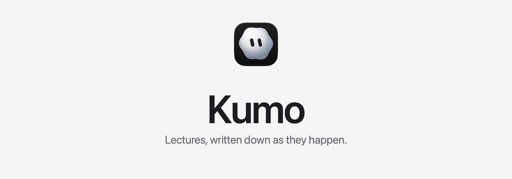

<p align="center">
  <picture>
    <source media="(prefers-color-scheme: dark)" srcset="docs/banner-dark.png">
    
  </picture>
</p>

<p align="center">
  <a href="https://github.com/Darkyyto/kumo.app/releases/latest/download/Kumo.dmg"><b>Download for Mac</b></a>
  &nbsp;·&nbsp;
  <a href="https://github.com/Darkyyto/kumo.app/releases">Releases</a>
  &nbsp;·&nbsp;
  <a href="https://github.com/Darkyyto/kumo.app/issues">Report a problem</a>
</p>

<p align="center">
  <a href="https://github.com/Darkyyto/kumo.app/releases/latest"></a>
  
  
  <a href="LICENSE"></a>
</p>

# Kumo

Kumo writes down your lectures and meetings as they happen. Press Start, read along while the words appear, press Stop, give it a name. Kumo then listens to the whole recording again with a more accurate model, fixes the words that were hard to hear and writes clean notes, a summary and flashcards (or minutes with action items).

Everything is one window: record on the left, the words as they come, or everything you recorded before, on the right, with search.

## Installing

Download [`Kumo.dmg`](https://github.com/Darkyyto/kumo.app/releases/latest/download/Kumo.dmg), open it and drag Kumo into Applications. Or run one line in Terminal:

```sh
curl -fsSL https://raw.githubusercontent.com/Darkyyto/kumo.app/main/Scripts/install.sh | sh
```

Kumo is not notarized by Apple, so the first time macOS asks you to confirm it in **System Settings › Privacy & Security › Open Anyway**. After that, updates install themselves.

If you used FocusKit's lectures before, Kumo finds them on its own the first time it opens. Nothing is moved or deleted.

## How it works

- **Live transcript.** Words appear as people speak, on device. Quiet or distant voices are boosted and low hum is filtered out.
- **Safe recordings.** The transcript is saved every few seconds and the audio survives a crash. An interrupted recording is recovered the next time Kumo opens.
- **Notes.** After you stop, Apple Intelligence writes notes, a summary and flashcards. Turn it off in Settings if you only want the transcript.
- **Merge, export, search.** Join two parts of the same lecture, export as PDF, search titles, transcripts and notes.
- **Light on the battery.** No animation, nothing running while you are not recording.

## Privacy

There is no account, no analytics and no server. Audio, transcripts and notes stay on this Mac. Kumo goes online only to download the speech model for your language once, and to check GitHub for a new version, which you can turn off in Settings.

Record lectures and meetings only where you are allowed to, and ask first when in doubt.

## Building

Requires macOS 26, Xcode 26 and [XcodeGen](https://github.com/yonaskolb/XcodeGen).

```sh
make run
```

| Command | What it does |
| --- | --- |
| `make run` | Builds a debug copy and opens it |
| `make dmg` | Builds a universal release in `dist/` |

## License

Kumo is free to use for personal, study and other noncommercial purposes under the [PolyForm Strict License 1.0.0](LICENSE). The source is published so you can see how it works and what it does with your data. Modifying it, redistributing it or publishing derived apps is not permitted.

<p align="center"><sub>Made by <a href="https://salise.design">Salise Studio</a></sub></p>
